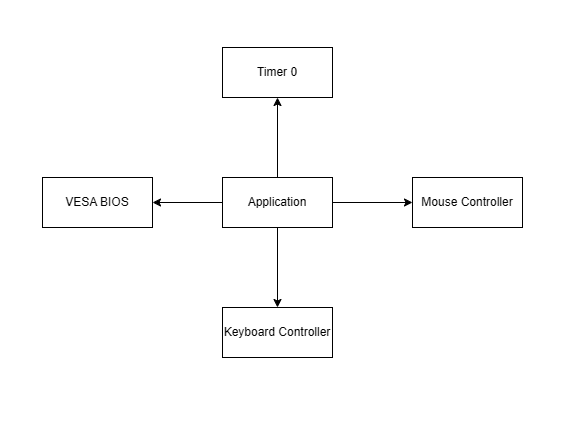
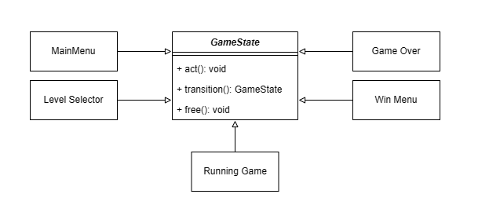
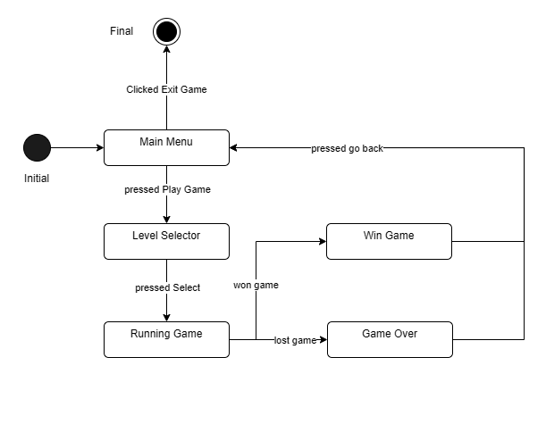

# Report 
## Disclaimers 
All images used in this project were obtained from publicly available sources on the Internet. We do not own or claim any rights to these sprites. The assets used include the <a href = "https://pixelfrog-assets.itch.io/tiny-swords">Tiny Swords</a> sprite sheet by Pixel Frog, the <a href = "https://foozlecc.itch.io/void-environment-pack">Void Envorinment Pack</a> by Foozle, the <a href = "https://nyknck.itch.io/pixelarteffectfx017">Fireball effect</a> by NYKNCk all of which are distributed under the CC0 license. We also used sprites from the game Bad Ice Cream by Studio Nitrome and one AI generated animation.

This project was created solely for educational purposes.

## Declaration of Responsible AI Use

We declare that:

1. We are responsible for all code and documentation in this repository, and we understand that we must be able to explain and justify any part of it on request.  
2. We have used AI-based tools (e.g., code assistants, chatbots, or generators) only to support my learning, not to bypass the intended learning outcomes or any assessment rules.  
3. Wherever AI tools contributed to this work, we have:  
   - Used them within the limits set by the course policies and institutional regulations.  
   - Reviewed, tested, and, where necessary, edited the outputs, taking full responsibility for their correctness, originality, and legality.  
   - Ensured that no confidential, personal, or sensitive data were shared with AI tools.  
4. We have not used AI tools to generate complete solutions that we present as entirely our own unaided work, and we have avoided plagiarism, whether from AI outputs or other sources.  
5. If asked, we will provide details of which tools we used, for which files or parts of the project, and how we verified and adapted their outputs.

Signed: Gustavo Bastos, Isaac Santos, Dalton Yuiti Kitadani Liaw Djoesman, Tiago Su
Date: 26 de Fev / 2026

## What was our goal 
For this project, we aimed to create a tower defense game, a genre of games which players need manage resources and build defenses across the map in order to protect themselves from waves of enemies. The core gameplay loop involves gathering fruits and it to build towers that automatically attack enemies as they approach in successive waves.

TODO insert game image

## How did we structure the project
For our project, we adopted an OOP approach focusing on the SOLID principles, particulary the Single Reponsibility Principle. Altough, due to time constraints, we were unable to fully accomplish it in all files. Regardless in a general view, we can define the flow of our project in this abstract UML.

### Aplication
The <a href="./project/src/application.c">application.c</a> is the entry point of our project, it is the file that starts our program and mainly handles all the initialization of the drivers and their interruptions. And it also has a Game object whose update method is called for each timer 0 interrupt.

### Game
The <a href="./project/src/game.c">game</a> class has the responsability to handle the state of the game, i.e. it should be able to do all the necessary actions of each state and be able to transition between them. For that reason, we designed a state machine with the correspoding states:
- Main Menu: state that should show the startup menu
- Level Selector: state that should show a menu in which you can choose which level to play
- Running Game: state that should display the actual game
- Game Over: state that should display when you lose
- Win Game: state that should display when you win

### Arena 
The <a href="./project/src/arena.c">Arena</a> class is just big wrapper that holds all running objects from the running game and calls their update methods. Beside being a wrapper, it also holds some auxiliar functions to help components connect with other objects for example a method to help colliders detect if they are colliding with some other objects or a method to check if the game is over.

### Components
To explain the rest of our project, we need to explain the components directory. These are black boxes classes that should have only purpose and should be independent or only needing of others components in order to work. These files were the first structure created for our project and we used some ideas from game engines like Unity and Godot to help start our project, for that reason we have defined that we would need the following components:
- <a href="./project/src/boxCollider.c">BoxCollider</a>: a simple object that represent a rectangle hitbox
- <a href="./project/src/rigidBody.c" >RigidBody</a>: a component that needs a collider and handles all necessary movement for objects that need to collide with other objects (used for the player)
- <a href="./project/src/timer.c">Timer</a>: a component to countdown time
- <a href="./lab5/spriteXMP.c">SpriteXPM</a>: a component that should be able to handle the displaying of a XPM
- <a href="./project/src/animatedSprite.c">AnimatedSprite</a>: a component able to display animations 
- <a href="./project/src/button.c">Button</a>: a component that has a onClick and onHover function

### Player
The <a href="./project/src/player.c">Player class </a> follows something similar to a MVC architecture with only a <a href="./project/src/playerModel.c">model class </a> and <a href="./project/src/playerController.c"> logic class </a> to handle the visual and controller. To handle all variations of player states, we defined a game state to handle all player inputs and their logic and process which visual to display. To help manage easier the player, we use Animated Sprites to display different animations depending in which action the player is doing, a rigidbody to abstract all functions that handles collisions with walls and boxColliders to represent the player hitbox.

### Tile and Collectable
The <a href="./project/src/tile.c"> Tile class </a> and <a href="./project/src/collectable.c"> Collectable class </a> are classes that have a boxcollider and spriteXPM and they represent a generic tile to display in the map. The collectable is special in a way that it disapears after being collected in order to represent the fruits from the game which the player needs to collect. And in order to detect the collisions with the fruits, we use the arena as observer to analyse which collectable collided with the player.

### Generic Tower and Projectiles
In order to have a modular to generate different types of tower, we decide to define inheritance approach to implement the towers. So we defined the generic tower as an abstract class that is implemented by diverses type of towers:
- <a href="./project/src/basicTower.c">Basic Tower</a>;
- <a href="./project/src/basicLongTower.c">Long Tower</a>;
- <a href="./project/src/fastTower.c">Fast Tower</a>;
- <a href="./project/src/piercingTower.c">Piercing Tower</a>;
- <a href="./project/src/eletrictTower.c">Eletric Tower</a>;
- <a href="./project/src/mortarTower.c">Mortar Tower</a>;

Beside that, each towers also has a projectile stored in it. The <a href="./project/src/projectile.c"> Projectile class </a> also uses inheritance to create modular structure to create projectiles, doing so we created the following types of projectiles:
- normal: a normal projectile that stops after the first valid collision
- piercing: a projectile that pierces everything until hits a wall
- sky fall: a projectile that falls from the sky and it is affected by gravity
- near: an immobile projectile 

### Monsters
Someone that knows fill it

## What devices did we use
### VESA BIOS
The most obvious usage of a driver is the VESA BIOS which was used to fill the VRAM and display images on the screen. This driver can be seen wrapped in the object <a href="./lab5/terminal.c"> Terminal </a> used in conjuction with <a href="./lab5/spriteXMP.c"> SpriteXPM </a>. Besides the basic functionalities from labaratories exercises, we also used the page flipping in order to avoid screen tearing (NOTE: in order to implement the page flipping, we resorted to AI assistance).

### Keyboard Controller
The keyboard driver was used to detect which state the keys from the keyboard are on. It was important to detect if a key is being held, if it was the first instance of being held or it is not being pressed, that's why we defined an enum to represent that states. All logic from the driver handling is wrapped in a singleton called <a href="./project/src/inputHandler.c"> InputHandler</a> with a simple API to be used. We decided to design this as a singleton because during all the project execution, we only have one object that will change the state of the singleton and the rest of the program only queries the state of the keyboard is in, making the usage of a singleton for this purpose optimal and easier to maintain and access to keyboard information.

### Mouse Controller
The mouse was used to display a cursor and to be able to interact with UI. All logic is abstracted inside the <a href="./project/src/cursorHandler.c"> CursorHandler class </a> which handles all controllers' data sent by the Application class and it also handles its own visual display. Similar to the keyboard controller, this class was designed as singleton because of the same reasons from the keyboard, there is only one class that changes the state of this object and the rest of the game only request information.

### Timer 0 - interrupt
The Timer 0 was primarily used to have a game running 60 FPS so that every time, the interrupt is fired we execute a game loop.

### RTC - not used
During our project development, we tried to think in useful ways to use the RTC and the only valid option that came to mind was to use to calculate the deltaTime or the elapsed time between frames. But unfortunately, the RTC is too slow and was hindering our game performance so we decided to discard the idea and use the timer 0 to calculate the deltaTime.

## What are the differentiating features of our project?
Using an OOP approuch, we believe we reached a very complete and complex project, with a game that starts and ends very concisely. The big differentiating feature is how we designed our project because from the beginning, we always preoccupied in making modularity as the main point of all classes. That led us to a project that is very easy to add new features, new levels, new towers, new enemies and easy to maintain at a certain degree of understanding of the codebase. Although, due to time constraints, the Arena became not very modular. 

Beside the modularity of our code, we could say that we created a very complete and enjoyable game.

## Authors and acknowledgment

LCOM Project for group GRUPO_2LEIC13_2.

Group members: 
Dalton Yuiti Kitadani Liaw Djoesman (up202407080@up.pt) 
Gustavo Bastos (up202403874@up.pt) 
Isaac Santos (up202407099@up.pt) 
Tiago Su (up202403468@up.pt) 